  <picture>
    <source media="(prefers-color-scheme: dark)" srcset="./dark.svg">
    <source media="(prefers-color-scheme: light)" srcset="./light.svg">
    
  </picture>

<h1 align="center">Hi, I'm Zoyabi Shaikh</h1>

  CSE–Data Science Student · Python & Data Science · Exploring AI/ML

I’m a Computer Science and Engineering student specializing in Data Science. I enjoy exploring the space between software, data, and design, and learning by building practical projects.

## Focus

- Python development and data analysis
- Data preprocessing and interactive dashboards
- UI/UX prototyping and digital product concepts
- Exploring AI/ML

## Selected work

- **Meraqi** — An online art-learning app concept focused on live learning experiences.
- **Data-preprocessing dashboards** — Streamlit coursework projects exploring preprocessing and data-quality workflows.

## Toolkit

`Python` · `Streamlit` · `Pandas` · `NumPy` · `Matplotlib` · `scikit-learn` · `Figma` · `Canva`

## Currently

Building my technical foundations, experimenting with projects, and growing as an engineer and designer.

## Connect

- [GitHub](https://github.com/zoyanoirlilrapunzel)
- [LinkedIn](https://www.linkedin.com/in/zoyabi-shaikh-4b2294374/)

<i>building quietly, dreaming big.</i>

