<picture>
  <source media="(prefers-color-scheme: dark)" srcset="./dark.svg">
  <source media="(prefers-color-scheme: light)" srcset="./light.svg">
  
</picture>

## Hi, I'm Zoya 👋

I'm a Computer Science and Engineering student specializing in Data Science. I enjoy exploring the space between software, data, and design, and learning by building practical projects.

### Focus
- Python development and data analysis
- Data preprocessing and interactive dashboards
- UI/UX prototyping and digital product concepts

### Selected work
- **Meraqi:** An online art-learning app concept focused on live learning experiences.
- **Data-preprocessing dashboards:** Streamlit coursework projects exploring preprocessing and data-quality workflows.

### Toolkit
`Python` · `Streamlit` · `Pandas` · `NumPy` · `Matplotlib` · `scikit-learn` · `Figma` · `Canva`

### Currently
Building my technical foundations, experimenting with projects, and growing as an engineer and designer.

---

*building quietly, dreaming big.*
